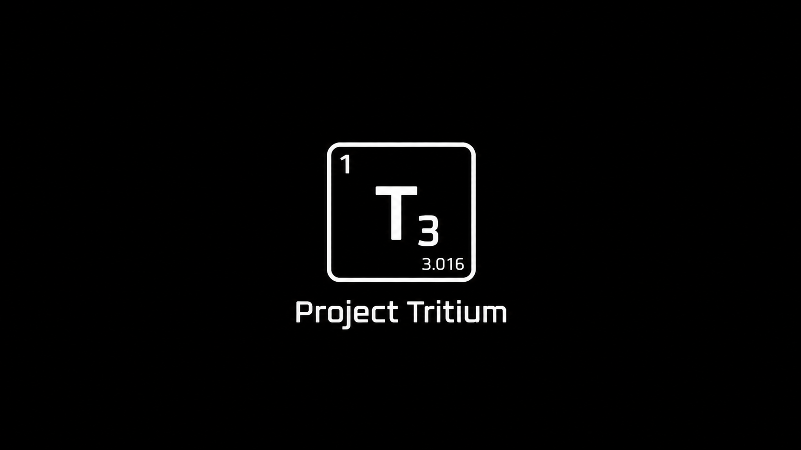

# ULTRIUMA AndroLua Native Enhancement Libraries



---

[](LICENSE)
[](https://github.com/ULTRIUMA/AndroLua-OpenCode-Build/releases)

[](https://github.com/ULTRIUMA/AndroLua-OpenCode-Build)

[](http://qm.qq.com/cgi-bin/qm/qr?_wv=1027&k=ZUpmaLOmyaPPttW-BVXBk9fIxlYuYH3j&authKey=DTuycx5nS0c96n0tjximGLCp4o%2Bq6IAAkKY6%2BXBJM4v9aSkIj1tLCLnEtikM%2BpHM&noverify=0&group_code=741053208)
[](mailto://hainacloud@foxmail.com)
[](https://t.me/ULTRIUMA)

---

> 一套面向 **AndroLua / Lua** 的 Android 原生增强资源，由 **ULTRIUMA** 编译维护。
> A curated set of Android native extensions for **AndroLua / Lua**, compiled and maintained by **ULTRIUMA**.

---

## 目录 / Table of Contents

- [项目概览 / Overview](#项目概览--overview)
- [目录结构 / Directory Structure](#目录结构--directory-structure)
- [1. Markdown 渲染 / Markdown Rendering](#1-markdown-渲染--markdown-rendering)
  - [1.1 MarkdownView](#11-markdownview)
  - [1.2 MarkwonX](#12-markwonx)
- [2. MMKV Lua 绑定 / MMKV Lua Binding](#2-mmkv-lua-绑定--mmkv-lua-binding)
- [3. 原生库集合 / Native Library Collection](#3-原生库集合--native-library-collection)
- [4. OpenLuaEvo](#4-openluaevo)
- [5. 许可证 / License](#5-许可证--license)

---

## 项目概览 / Overview

| 模块 / Module | 用途 / Purpose | 最新版本 |
| --- | --- | --- |
| `markdown/MarkdownView/` | WebView 离线 Markdown 渲染 + 导出 API | v1.5.4 |
| `markdown/MarkwonX/` | Markwon + Prism4j Markdown 渲染 | v1.0.0 |
| `mmkv/` | 腾讯 MMKV Lua 绑定（单 so） | v1.0.0 |
| `Nativelib/` | 28 个预编译原生 .so 库 | — |
| `OpenLuaEvo/` | AndroLua IDE 签名 APK + 打包脚本 | v1.6.4-build2 |

---

## 目录结构 / Directory Structure

```
AndroLua-OpenCode-Build/
├── License
├── README.md
├── markdown/
│   ├── README.md
│   ├── MarkdownView/
│   │   ├── License
│   │   ├── README.md
│   │   ├── MarkdownView_v1.0.0.dex
│   │   ├── MarkdownView_v1.2.0.dex
│   │   ├── MarkdownView_v1.2.4.dex
│   │   ├── MarkdownView_v1.3.0.dex
│   │   ├── MarkdownView_v1.5.4.dex
│   │   └── src/com/ocssfun/markdown/   # Java 源码
│   └── MarkwonX/
│       ├── License
│       ├── README.md
│       └── MarkwonX_v1.0.0.dex
├── mmkv/
│   ├── License
│   ├── README.md
│   ├── LuaMMKV.lua
│   └── lib/{arm64-v8a,armeabi-v7a,armeabi}/
├── Nativelib/
│   ├── License
│   └── {arm64-v8a,armeabi-v7a,armeabi}/ (29 个 .so × 3 ABI)
├── OpenLuaEvo/
│   ├── README.md
│   ├── build-1/     # v1.6.4 签名 APK
│   ├── build-2/     # v1.6.4-build2 签名 APK
│   ├── lua/         # bin.lua 打包脚本
│   ├── utils/       # LuaIcon.lua 等工具
│   └── html/        # 文档
└── opencc/          # 简繁转换资源 + so
```

---

## 1. Markdown 渲染 / Markdown Rendering

### 1.1 MarkdownView

继承自 `WebView` 的离线 Markdown 渲染控件，编译为独立 `classes.dex`，供 AndroLua `loadDex` 加载。

- **完全离线**：marked 12 / highlight.js 11 / KaTeX 0.16 已内联，零外部依赖
- **双内置样式**：ULTRIUMA（默认）/ GitHub（Primer 风格），均带完整亮暗双主题
- **导出 API**（v1.5.4）：支持导出 Markdown / 纯文本 / HTML / 截图 PNG / Bitmap
- **源码已开放**：`src/com/ocssfun/markdown/` 下 5 个 Java 源文件
- 产物约 1.8 MB，min-api 21，第三方 Java 依赖：**无**

**最新版 v1.5.4 — 导出 API：**

```lua
require "import"
import "com.ocssfun.markdown.*"
import "com.ocssfun.markdown.MarkdownView"

local mdv = MarkdownView(activity)
frame.addView(mdv)
mdv.setMarkdownText("# Hello")

-- 导出为 HTML
mdv.setExportFormat(MarkdownView.EXPORT_FORMAT_HTML)
mdv.doExportAndCallback({
  onExport = function(code, content)
    if code > 0 then print("OK: " .. content) end
  end,
  onExport = function(format, bitmap)
    print("Bitmap: " .. bitmap.getWidth())
  end
})
```

> 详细 API 参见 [markdown/MarkdownView/README.md](markdown/MarkdownView/README.md)
> Release 下载提供 4 种包：dex+doc / dex / src+doc / src，均含 License

### 1.2 MarkwonX

基于 **Markwon 4.6.2 + Prism4j** 的 Markdown 渲染 dex，含深色主题、圆角引用块/行内代码、可点链接、图片与 shields.io SVG 徽章。约 7.6 MB，5844 类，min-api 21。**不含 LaTeX 公式**。

```lua
import("com.ocssfun.markwon.MarkwonSetup")
local mk = MarkwonSetup.create(activity)
mk:setMarkdown(textView, "# 标题\n\n```lua\nprint('hi')\n```")
```

> 选型：需要**离线、带公式、WebView 显示**用 MarkdownView；需要**嵌入 TextView、插件扩展**用 MarkwonX。

---

## 2. MMKV Lua 绑定 / MMKV Lua Binding

把腾讯 [MMKV](https://github.com/Tencent/MMKV)（v2.4.2）C++ Core + Lua 5.3 绑定编译为**单个** `libmmkv.so`，供 AndroLua `require("mmkv")` 直接调用。

```lua
local mmkv = require("mmkv")
mmkv.init(activity.getFilesDir().getAbsolutePath() .. "/mmkv", mmkv.LOG_NONE)
local kv = mmkv.defaultMMKV()
kv:set("name", "value")
print(kv:getString("name"))
```

> 详细 API 参见 [mmkv/README.md](mmkv/README.md)

---

## 3. 原生库集合 / Native Library Collection

`Nativelib/` 含 28 个预编译原生库 + `libc++_shared.so`，按 3 个 ABI 各 29 个 `.so` 分发。

主要库：base64 / bson / cjson / canvas / gl / lfs / lpeg / lsqlite3 / luajava / luv / md5 / mmkv / opencc / regex / socket / sqlite3 / tcc / xml / yaml / zip / zlib …

> 注意：若已静态链 `c++_static`（如 `libmmkv.so`），应避免同时加载 `libc++_shared.so`。

---

## 4. OpenLuaEvo

OpenLuaEvo v1.6.4 签名版 APK + `bin.lua` 打包脚本，多 ABI 分发。

| 版本 | 说明 |
| --- | --- |
| v1.6.4 (build-1) | 初始签名版 |
| v1.6.4-build2 | 修正 res/drawable、替换测试图标、bin.lua 自动打包 slot 图标 |

**bin.lua 用法：**

```lua
local bin = require "bin"
bin(activity.getLuaExtDir("project/myapp") .. "/")
```

> 详细内容参见 [OpenLuaEvo/README.md](OpenLuaEvo/README.md)

---

## 5. 许可证 / License

本仓库全部内容采用 **Apache License 2.0**。

- 文本全文：<http://www.apache.org/licenses/LICENSE-2.0>
- 第三方组件（marked / highlight.js / KaTeX / Markwon / Prism4j / MMKV 等）以其上游声明为准。

> 编译与维护 / Compiled & maintained by **ULTRIUMA**.
